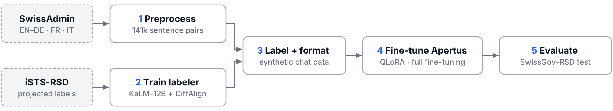

# Apertus for Cross-lingual Recognition of Semantic Differences (RSD)
- **Track:** `Track 2A — UZH`
- **Event:** Online
- **Team:** `Gian Macagni, Tim Kessler`
- 
## 1. Summary

In our project we show how Apertus 1.5 8B can be adapted to a fine-grained, low resource task, namely token-level recognition of semantic differences between related documents in a cross lingual setting. Our work builds on the benchmark defined by the SwissGov-RSD. Because there exist no large human-labelled training data, we decided to generate synthetic training data. We used the aligned SwissAdmin press-release corpus for its similarity of domain and because the required language pairs were already present in a similar style of translation. The words were labeled by an encoder model that we previously trained for the task on the projected SemEval-2016 iSTS corpus. For this we used KaLM-12B encoder and MLP heads as well as DiffAlign. With the resulting datasets we fine-tuned Apertus 1.5 8B with QLoRA and in a full train run with weighted loss. 

The fine-tuned models were then evaluated on the SwissGov-RSD corpus via Spearman rank correlation on the gold labels. As a baseline, we also ran the evaluation on the base model (Apertus 1.5 8B). To refine the output and avoid invalid JSON responses from the model, we constrained the model output with llguidance grammar. As a basis for our evaluation prompt, we used the monolingual evaluation prompts from the SwissGOV-RSD paper and refined them into one multilingual prompt.
## 2. Architecture

Jupyter notebooks were used for the full pipeline. Three make up the workflow for the creation of the synthetic data, two notebooks were used for training and another one for model evaluation. Besides that we also created a modified version of the original SwissGov-RSD evaluation prompt template and used enforced decoding generation with a special grammar to ensure valid JSON output.

### Training Corpus preparation and Preprocessing

- **`synthetic_data_1_preprocess.ipynb`** 

We used the data present in the SwissAdmin aligned corpus (2014-05-26) in the three present languages EN–DE, EN–FR, EN–IT and segmented them on the datelines. Furthermore we used regex tokenisation on word-level to tokenize into word-level tokens with punctuation as separate items, matching the SwissGov-RSD format. The data was then checked against the SwissGov-RSD test split for overlap. As output we got 49,518 / 48,209 / 43,519 sentence pairs in ~11.2k documents.

### Labeler training

- **`synthetic_data_2_train_encoder.ipynb`**

To label the corpus we built a teacher model on the `tencent/KaLM-Embedding-Gemma3-12B-2511` encoder, using hidden layer −19. Each document is encoded after the other document, so every word has already seen the full other text, and subword states are summed into one vector per word. On these vectors we trained five MLP heads on the projected iSTS-RSD train split, using 3,000 pairs per language concatenated in groups of six to mimic document length. Because the heads transfer poorly to government documents, we blended them 50/50 with the unsupervised DiffAlign score. Finally, we smoothed each score with its neighbours and quantised it to six levels. The labeler reaches a Spearman correlation of 31.0 on SwissGov-RSD dev.

### Synthetic dataset creation

**`synthetic_data_3_create_data.ipynb`** 

With the labeler we scored every word of the cleaned corpus, processing long documents in chunks of at most 2,800 words per side. The scores were mapped to the benchmark scale from 5 (equivalent) to 0 (unrelated), with −1 for punctuation, and hyphens and apostrophes were split into their own items. Each document pair was then turned into a chat example: a few-shot prompt with one example per language pair, followed by the target JSON. We held out 2 % of the documents for validation, keeping all language versions of a document on the same side of the split.

### Apertus 1.5 Training

#### Quantized LoRA

- **`synthetic_train_run_quantized.ipynb`** 

We fine-tuned `swiss-ai/Apertus-v1.5-8B` with QLoRA, using a 4-bit base model and LoRA adapters on all linear layers of the language model. Documents with few differences were partly filtered out to rebalance the data. A weighted loss puts most of the weight on the score tokens, extra weight on scores below 5, and little weight on the copied words. The model was trained for two epochs, and the best checkpoint was selected by validation loss.

#### Full Training

- **`synthetic_train_full_4gpu.ipynb`**

As a comparison to QLoRA, we fine-tuned all weights of the Apertus language model and `lm_head` without quantisation or LoRA, while keeping the vision and audio components frozen. Training ran with FSDP2 on four GPUs, one process per GPU, using bf16 compute with fp32 master weights and activation checkpointing. Data, prompt, rebalancing, weighted loss and the effective batch of 16 documents per step are the same as in the QLoRA run, but the learning rate is lower (1e-5 instead of 2e-4). The final model is saved as a standard Hugging Face checkpoint. Full fine-tuning did not beat QLoRA (30.3 vs 31.5 pooled Spearman).
  

### Evaluation and Constrained Decoding 

- **`RSD_Validation_Pipeline_batched_calls.ipynb`**

- every word and its position is fixed so the model only fills in the scores.

Evaluates any model served behind an OpenAI-compatible endpoint on recognizing semantic differences in the SwissGov-RSD dataset. In practice, we serve the base model, QLoRA adapter and the fully fine-tuned model with vLLM on CSCS Clariden via `model-launch`.

Each document pair (EN-DE, EN-FR or EN-IT) is attached to a multilingual few-shot prompt (`FEWSHOT_PROMPT_MIXED`, based on the monolingual SwissGov-RSD prompts) that is sent to the model as one user message. The model is prompted to evaluate the semantic differences on a token level between the two documents with one input/output example per language pair.

In addition to that, the notebook builds an [llguidance](https://github.com/guidance-ai/llguidance) grammar ([Lark-like syntax](https://github.com/guidance-ai/llguidance/blob/main/docs/syntax.md)) for each document pair. This grammar consists of a JSON template with every word already fixed and only the seven gold labels as score choices, so the model is only allowed to fill in the scores it computed for each token. The scores are as follows: 5 = equivalent, 0 = unrelated (with an interval of 1 between these max/min values) and -1 = punctiation. The grammar is sent with the request through [vLLM's `structured_outputs`](https://docs.vllm.ai/en/latest/features/structured_outputs/#online-serving-openai-api) variable. As a result the output is always valid JSON (no invention, merge or splitting of words possible and JSON structure enforced), there is only one score per token (predictions line up 1:1 with the gold labels) and the model only decides between the seven gold labels.

Scores are then mapped to the gold scale (`5->0.0`, `4->0.2`, `3->0.4`, `2->0.6`, `1->0.8`, `0->1.0` and `-1->-1.0`) and Spearman rank correlation between the predicted values and the gold labels are computed. The results are then saved to `comparison.csv` where different models can be compared.

## 3. Use of Apertus

### **Model:** `swiss-ai/Apertus-v1.5-8B`
 
#### **How it is used:**
 
##### Fine-tuning (QLoRA) + evaluation as a token-level annotator

|Setting|Value|
|---|---|
|Quantisation|4-bit NF4, double quant, bf16 compute|
|LoRA|r = 32, α = 64, dropout 0.05, all linear layers of the language-model blocks|
|Data filter|≤ 12,288 tokens; documents with < 8 % differences kept with p = 0.3 (rebalancing)|
|Loss|weighted completion-only CE: copied words 0.1, score tokens 1.0, scores 0–4 ×3|
|Optimisation|2 epochs, batch 1 × accum 16, lr 2e-4 cosine, 3 % warmup, paged AdamW 8-bit|
|Model selection|eval loss every 200 steps on 60 held-out documents|

##### Full training

| Setting | Value |
|---|---|
| Precision | no quantisation, no LoRA; bf16 compute with fp32 master weights (FSDP mixed precision) |
| Trained parameters | all weights of the language model + `lm_head`; vision/audio components frozen |
| Parallelism | FSDP2 on 4 GPUs (one process per GPU via `torchrun`), sharded per `Apertus1p5TextDecoderLayer`, activation checkpointing |
| Data filter | ≤ 12,288 tokens; documents with < 8 % differences kept with p = 0.3 (rebalancing) |
| Loss | weighted completion-only CE: copied words 0.1, score tokens 1.0, scores 0–4 ×3 (logits computed only at loss positions) |
| Optimisation | 2 epochs, batch 1 × accum 4 × 4 GPUs = 16 documents/step, lr 1e-5 cosine, 3 % warmup, fused AdamW |
| Checkpointing | sharded checkpoints every 200 steps (resumable); final model gathered into a standard Hugging Face folder |
| Model selection | eval loss every 200 steps on 60 held-out documents |

##### Inference
|Setting|Value|
|---|---|
|TEMPERATURE|0|
|MAX_TOKENS|40000|
|MAX_CONCURRENCY|64|
|SEED|42|

#### **Where it runs:** 

All notebooks run in dedicated docker containers specified in the `Makefile`. Besides  `syntetic_train_full_4gpu.ipynb`  which is designed to run on CSCS or a similar system with multiple GPUs and enough memory, all other pipelines will run on any system that has a GPU that is able to use the CUDA framework. The `RSD_Validation_Pipeline_batched_calls.ipynb` will run on any machine but depends on an external inference provider.

## 4. Data

|Data|Use|Source|
|---|---|---|
|SwissAdmin aligned corpus (2014-05-26)|input texts for synthetic data|Yves Scherrer, Luka Nerima, Lorenza Russo, Maria Ivanova, Eric Wehrli (2014). SwissAdmin - A multilingual tagged parallel corpus of press releases. Proceedings of LREC 2014. Reykjavik, Iceland.|
|iSTS-RSD (projected, train/valid)|train / tune the teacher|ZurichNLP/SwissGov-RSD repo, derived from SemEval-2016 iSTS|
|SwissGov-RSD validation (504 rows)|evaluation; token→punctuation map|ZurichNLP/SwissGov-RSD (HF)|
|SwissGov-RSD test (168 rows)|only for the n-gram leakage filter|ZurichNLP/SwissGov-RSD (HF)|

## 5. Evaluation

Spearman correlation (×100) with gold labels, all numbers on **SwissGov-RSD test**. Pooled Spearman correlation (x100) improves from 3.346 for the base model to 30.319 and 31.464 for the QLoRA adapter and full fine-tuned model respectively. We do not observe a noticable difference between the QLora and full fine-tune run.

|Setup|Pooled|EN–DE|EN–FR|EN–IT|
|---|---|---|---|---|
|Apertus-8B, few-shot (no fine-tuning)|3.346|5.99|5.33|-1.12|
|Apertus-8B + weighted QLoRA, few-shot|31.464|43.3|14.43|36.29|
|Full fine-tuned Apertus-8B, few-shot|30.319|39.04|16.61|34.62|

## 6. Limitations

- Synthetic labels inherit the teacher's errors (dev Spearman ca. 31.0); the teacher over-predicts differences (19.3 % vs. 13.7 % gold) and is weakest on EN–FR.
- Hyper-parameters were selected on iSTS, but SwissGov dev scores were displayed during the α/smoothing sweeps.
- Long documents: > 2,800 words/side or > 12,288 tokens are dropped from training; greedy generation of very long JSON can truncate or misalign items.
- Only three language pairs were used in training, as well as only one domain.

## 7. Reproducibility

Adapt `.env` according to the `README.md`, follow the `README.md` instructions and run `make run`.

## 8. Next steps

- Improve the quality of the synthetic data either with a better scorer for the first step or better in domain data
- Upscaling to Apertus 70B on the same synthetic data
- LLM2vec style implementation with the same data e.g. apertus as a bidirectional encoder with a token-classification head, trained on the same synthetic labels. Possibly with a swich or mechanism to still allow normal generation. This could benefit the scoring while keeping the model fully functional as intended. Longer compute time and a more difficult training setup would be the downside of this approach. 

## License

Creative Commons Attribution 4.0 (CC-BY-4.0). All HackApertus projects are open-sourced.

## References

- Wastl, Vamvas, Sennrich (2026). _SwissGov-RSD: A Human-annotated, Cross-lingual Benchmark for Token-level Recognition of Semantic Differences Between Related Documents._ ACL 2026. [https://aclanthology.org/2026.acl-long.1437/](https://aclanthology.org/2026.acl-long.1437/)
- Vamvas, Sennrich (2023). _Towards Unsupervised Recognition of Token-level Semantic Differences in Related Documents._ EMNLP 2023 (DiffAlign, iSTS-RSD). [https://arxiv.org/abs/2305.13303](https://arxiv.org/abs/2305.13303)
- Scherrer, Nerima, Russo, Ivanova, Wehrli (2014). _SwissAdmin: A multilingual tagged parallel corpus of press releases._ LREC 2014. [https://aclanthology.org/L14-1602/](https://aclanthology.org/L14-1602/)
- Swiss AI Initiative. _Apertus._ [https://huggingface.co/swiss-ai](https://huggingface.co/swiss-ai)
- Tencent. _KaLM-Embedding-Gemma3-12B-2511._ [https://huggingface.co/tencent/KaLM-Embedding-Gemma3-12B-2511](https://huggingface.co/tencent/KaLM-Embedding-Gemma3-12B-2511)
